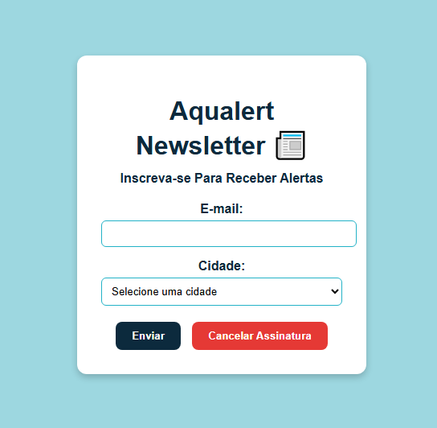

# Aqualert - Integração com Azure Functions 🔷

# Descrição
A fim de ter um controle maior sobre os registros de emails recebidos em nossa plataforma, foi implementado o serviço da <b>Azure Functions</b>, para assim termos um meio de cadastro para interessados em receber boletins climáticos da newsletter do aqualert.

## Sumário
- [Sobre a Ferramenta](#sobre-a-ferramenta)
- [Integrações](#integrações)
- [Estrutura do Projeto](#estrutura-do-projeto)
- [Funções](#funções)
- [Interface](#interface)
- [Documentações](#documentações)

## Sobre a Ferramenta
O Azure Functions é um serviço de computação serverless da Microsoft que permite executar pequenas partes de código (funções) na nuvem sem precisar gerenciar servidores. Ideal para automações, integrações e tarefas agendadas, ele é acionado por eventos como requisições HTTP, mensagens em fila, alterações em banco de dados, etc. Você paga apenas pelo tempo de execução do código.

## Integrações
* `Azure Functions`
    * Roda uma página html que recebe os dados de cadastros e os encaminha para o `Blob Storage`.
* `Blob Storage`
    * Faz o armazenamento dos dados de cadastros gravados pela função da azure.
* `Databricks`
    * Realiza a leitura, tratamento e encaminha os emails cadastrados na base de dados.
## Estrutura do Projeto
```
├── function_app.py # Arquivo principal com a função do Azure
├── host.json # Configuração global do host do Azure Functions
├── local.settings.json # Configurações locais, como variáveis de ambiente
├── requirements.txt # Dependências do projeto
```
## Funções
Nesta implementação possuímos uma função que faz a gerência das requisições e encaminha os registros para o armazenamento.
* Função `form_inscricao_email`
    * Exibe o formulário para cadastro, valida os campos e faz a gravação para o `Blob Storage`.
    * Rota definida para o trigger http
        * `https://crescerfunction.azurewebsites.net/api/aqualert/receber_alertas`

## Interface
- Formulário de Cadastro


## Documentações
- [Azure Functions Python developer guide](https://learn.microsoft.com/en-us/azure/azure-functions/functions-reference-python?tabs=get-started%2Casgi%2Capplication-level&pivots=python-mode-decorators)